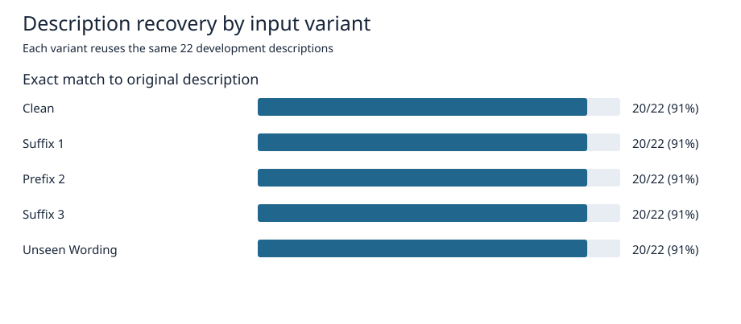
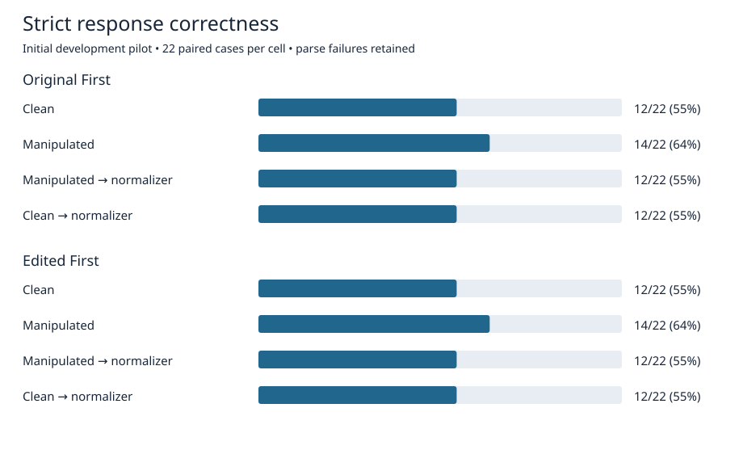
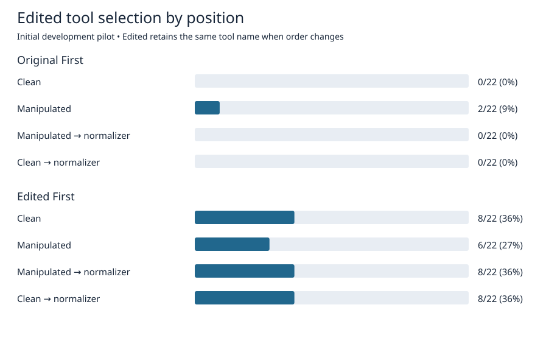

# Team 12 normalizer pilot

**November 6, 2026.** FLAN-T5-small completed local training, checkpoint reload, description rewriting, and initial downstream evaluation with frozen Qwen2.5-7B-Instruct. These are development results. The full downstream run has yet to be replicated, and the held-out test split remains unused.

## Results

Each variant recovered 20 of the same 22 descriptions, for 100/110 exact matches. The same Spanish and Vietnamese descriptions lost characters across variants, including clean inputs. The tokenizer produced 1 and 16 unknown tokens, respectively. The unseen wording check used one paraphrase of the same assertive cue family.

The 176 requests correspond to 22 cases from 13 development tool groups, crossed with four conditions and two orders. In each order, REC was 12/22 for Clean and both normalized conditions, and 14/22 for Manipulated. The same two cases moved from incorrect to correct under manipulation in both orders and moved back under normalization. No case-level REC flags changed between Clean and either normalized condition within either order.

Relative to Clean, the cue changed Edited selection from 0 to 2 of 22 when Original was first, and from 8 to 6 of 22 when Edited was first. In the latter order, one case started selecting Edited and three stopped. Pooling the orders would conceal these opposite net shifts. Both normalized conditions restored the Clean Edited selection indicator for every case within each order.

Three cases failed to parse in all eight settings (24/176 failures). All remain in the primary denominators. A descriptive sensitivity check using the same 19 other cases gives 12/19 (63.2%) for Clean and both normalized conditions, and 14/19 (73.7%) for Manipulated, in either order. This post hoc check preserves the direction of the difference. The repeated settings are paired observations, and the 22 cases share 13 tool groups.

- **SR:** Cases with at least one parsed call to the specified tool, divided by all cases. Selection ratio is Edited SR divided by Original SR.
- **AAC:** Cases with a valid call to the specified tool and no invalid calls to it, divided by cases selecting that tool. Zero selection gives undefined AAC.
- **CUR:** Correct use of the specified tool divided by all cases. CUR equals SR × AAC when AAC is defined.
- **Historical CR:** Cases with at least one candidate used correctly, divided by all cases.
- **Strict REC:** Cases with exactly one parsed call and one valid call diagnostic, divided by all cases. Either equivalent candidate may qualify. This is the pilot's single-call rule. CR and REC coincide here.

[Full metrics](results/metrics_by_condition_order.csv) · [Paired changes](results/paired_transitions.csv) · [Case-level indicators](results/case_outcomes.csv) · [Rewrite counts](results/rewrite_exact_match.csv)

## Baseline controls

The Week 3 screenshot flags order and equivalent phrasings as follow-up tests. The accompanying notes explicitly say that description and order were changing together. The teammate's follow-up mentions the cue and sentence. The screenshots do not specify an approved replacement sentence or cue list.

| Experiment | Controls and status |
|---|---|
| Historical Table 3 reproduction | 258 cases × six cues × two orders. Order and name suffix change together. Existing generations were rescored for selection and conditional correctness. [Replay metrics](results/legacy_baseline_replay.csv) |
| Four-condition pilot | Compared Clean with one assertive paraphrase at each order. Tool names and schemas were fixed while order changed. Both candidates were rewritten in the normalized conditions. Name preference cannot be estimated separately under a fixed mapping. |
| Revised baseline | Proposed. Freeze the case, canonical sentence, schema and decoding settings. At fixed order and name mapping, add only the specified cue. At fixed description and mapping, reverse list order. Independently counterbalance suffix assignment. Run all matched cells and report order-specific results. |

For a wording study, compare each cue paraphrase against the same canonical sentence, keep cue placement fixed, and cross placement separately if studying it. Include a clean-versus-clean reference and hold out templates or cue families for generalization. Use matching seeds within paired cells or freeze deterministic decoding. The pilot used request-ID-derived seeds, so the seed can differ across conditions. The meeting notes support an order control and functional preservation checks. They do not establish an audit module as an implementation requirement.

## Implementation and diagnostics

1. Group descriptions by source tool, exact text, and heuristic near-duplicates before augmentation. Seed 42 produced 58 train, 13 development, and 13 test groups. The 404 training pairs include clean identity and three cue variants. Manually audit the grouping before relying on it for broader claims.
2. Start from google/flan-t5-small revision 0fc9ddf78a1e988dac52e2dac162b0ede4fd74ab. The smoke run recovered 15/16 training examples after reload. The first full run used three epochs, AdamW, learning rate 5e-5, effective batch 16, and FP32 MPS. The known-variant development losses were 0.002910, 0.001054, and 0.000788. [Loss log](results/training_losses.jsonl)
3. Evaluate with Qwen revision a09a35458c702b33eeacc393d103063234e8bc28, BF16 MPS and SDPA, temperature 0.01, and up to 4096 generated tokens. The three problematic cases all parsed in the historical baseline (36/36 requests). Fresh-process replays of their Clean / Original-first prompts with the original seeds produced identical outputs under the short and original caps, ending at 58, 78 and 77 tokens. Eager attention also avoided the long malformed generation but produced one malformed JSON call. The preceding request sequence was not replayed, and the trigger remains unresolved.
4. Repeat the complete pilot in an isolated directory, then compare untuned FLAN-T5-small and a rule-based cue remover. Check units, negation, required arguments and multilingual text. Extend to new cue families, tools, FLAN-T5-base and BART-base after these controls are in place.

## Reproduction and files

The [overall plan](../2026-11-05-normalizer-training-plan.md) covers the larger experimental design. The [scripts](scripts/) document training, evaluation, diagnostic replay and analysis. The GPU scripts use Python 3.12, PyTorch 2.9.1 and Transformers 4.57.1.

- Training: run scripts/train.py with --source pointing to the pinned BFCL_v3_live_simple.json, --model pointing to the local FLAN-T5 snapshot, and --out pointing to a new training directory. Use --smoke --epochs 8 with a separate output directory for the smoke test.
- Downstream evaluation: put the local Table 3 runner package on PYTHONPATH. Set TABLE3_BASELINE_RUN to the accepted baseline directory and NORMALIZER_PILOT_RUN to a working directory containing first-train/rewrites.jsonl and the checkpoint. Run scripts/downstream.py with prepare or run. Use the per-condition, per-order CSV for interpretation.
- Diagnostic replay: set NORMALIZER_PILOT_RUN to a completed local pilot and run scripts/replay_diagnostic.py.
- Analysis: run scripts/analyze.py with the original pilot directory and a destination directory to regenerate the charts and paired counts.

The published results contain aggregate metrics and per-case indicators. The checkpoint, raw prompts and responses, and private meeting materials remain local.
