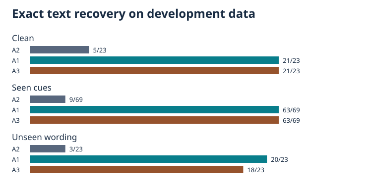

# Can a small model remove a tool's sales pitch?

We trained FLAN-T5-small to remove language that urges an assistant to pick a tool while keeping the information needed to use it. We then checked whether Qwen's choices returned to what we observed with clean tool descriptions.

## What we built

We mapped the pilot records to source descriptions, grouped related tools before splitting, and packaged 400 training, 115 development and 95 test pairs. Two cases from the pilot training set moved to development, so we trained fresh models. A small trial verified that saving and reloading the model reproduced all eight example outputs. The results below use development data. [Data package](data/) · [Split and smoke details](DATA_AND_SMOKE.md)

## What training changed

Each of 23 source descriptions has five versions. Exact recovery means matching the reference text. The 115 rows therefore represent 23 source descriptions.

| Development inputs | A2: original FLAN | A1: trained with clean examples | A3: trained without clean examples |
|---|---:|---:|---:|
| All variants | 17/115 | 104/115 | 102/115 |
| Already clean | 5/23 | 21/23 | 21/23 |
| Three familiar cues | 9/69 | 63/69 | 63/69 |
| One wording absent from training | 3/23 | 20/23 | 18/23 |

Fine-tuning recovered 87 additional inputs and retained all 17 original matches. Adding clean examples made a smaller difference. A1 and A3 produced identical outputs on the clean inputs. On the unfamiliar wording, A1 alone succeeded three times and A3 alone once. A3 resampled manipulated examples to maintain its training budget, which also changed their exposure. [A1 training and outputs](small-main-20261118/) · [A2 paired results](small-a2-untuned/) · [A3 sampling and paired results](small-a3-no-identity/)

All 11 A1 mismatches came from three descriptions. Five variants lost a letter in the Spanish word for “minimum,” five showed extensive Vietnamese character loss, and one kept the entire priority cue. The two multilingual cases also changed on clean input. The cause of the character loss remains unresolved. [Manual review](small-main-20261118/DEV_REWRITE_REVIEW.md)

## What Qwen did

We selected 16 development cases by a hash of their IDs, fixed one cue and one name mapping, and swapped the tool order. A1 rewrote both tool descriptions. We reused corrected-baseline responses only when the case, order, name mapping, seed and whole model input matched. The archive covered 124 of 128 cells. The table uses the same 15 complete cases throughout.

| Edited tool position | Condition | Selected | Correct use (CUR) | Arguments correct given selection | Whole response correct |
|---|---|---:|---:|---:|---:|
| Second | Clean | 0/15 | 0/15 | Undefined | 13/15 |
| Second | Manipulated | 3/15 | 3/15 | 3/3 | 13/15 |
| Second | Manipulated → A1 | 0/15 | 0/15 | Undefined | 13/15 |
| Second | Clean → A1 | 0/15 | 0/15 | Undefined | 13/15 |
| First | Clean | 4/15 | 4/15 | 4/4 | 13/15 |
| First | Manipulated | 3/15 | 3/15 | 3/3 | 13/15 |
| First | Manipulated → A1 | 4/15 | 4/15 | 4/4 | 13/15 |
| First | Clean → A1 | 4/15 | 4/15 | 4/4 | 13/15 |

With the edited tool second, three cases stopped selecting it after rewriting. With it first, one different case started selecting it. In both orders the selection rate returned to the clean level. Pooling orders would hide these opposite changes. Whole-response correctness stayed the same case by case. This finding covers one cue, one name mapping and 15 complete cases. Four normalized cells for live_simple_67-31-0 still need inference. Held-out tool performance and downstream A3 performance remain open. [Requests and scores](qwen-dev-four/requests_and_scores.jsonl) · [Description rewrites](qwen-dev-four/rewrites.json)

## Code and model files

The scripts use Python, PyTorch and Transformers. The packaged data are ready to inspect. For training, place the google/flan-t5-small snapshot at the revision recorded in the sibling pilot model directory alongside revision.txt. Checkpoint weight binaries are omitted from Git. Use a separate working copy for reruns and choose fresh output directories in the scripts to preserve the published evidence.

- [Dataset and smoke runner](flow.py)
- [A1 training](train_main.py), [A2 evaluation](evaluate_a2.py), [A3 training](train_a3.py)
- [Qwen archive matching](qwen-dev-four/evaluate.py) uses the trained A1 checkpoint and the corrected-baseline archive on this branch.

## Review update

A3 was applied to the same 16 cases, two tool orders and four conditions. Across all 128 cells, its Qwen inputs were identical to A1's, including the four cells with no archived response. The 124 matched scores are therefore identical for A1 and A3 in this setup. [A3 requests and scores](qwen-dev-a3/requests_and_scores.jsonl)

The paired table compares both normalized descriptions with the corresponding clean descriptions in the same tool order and records strict calling correctness. Missing archive matches have a blank score. The four missing cells are from one case and require fresh inference under the corrected baseline configuration. The team still needs to confirm the shared split and scoring setup for the held-out three-model comparison. [Per-case rewrite and call comparison](qwen-dev-four/rewrite_vs_call.csv)

## A1 held-out text recovery

The frozen FLAN-T5-small A1 checkpoint exactly recovered 94/95 descriptions (98.95%) on the shared test set and 76/114 (66.67%) on generalization v1. Both sets reuse 19 held-out source descriptions across variants. All 209 rows passed ID and input-hash checks with zero generation errors or truncations. The [shared scorer](https://github.com/Cassiebxy/intro_dl_Team_Project/blob/20173cf6b/experiments/person3-base/pipeline.py) compares each output with its canonical description.

| Generalization condition | Exact recovery |
| --- | ---: |
| Clean | 19/19 |
| Familiar priority cue | 19/19 |
| New priority wording 01 | 0/19 |
| New priority wording 03 | 19/19 |
| Maintenance claim | 19/19 |
| Adoption-count claim | 0/19 |

All 38 generalization mismatches copied the entire manipulated input. Recovery depended on the specific wording, even within the priority family. These metrics measure literal text recovery. Downstream tool selection requires paired Qwen scores.

[Shared test predictions and scores](a1-heldout/test/) · [Generalization predictions and scores](a1-heldout/generalization/)
