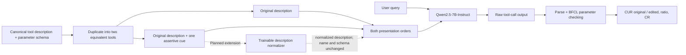

# 报告方法图素材（可编辑Mermaid）

已完成部分是双工具推理baseline；normalizer为拟议扩展。画入midterm时必须保留状态标注。

Baseline输入：用户query、两个工具的名称/description/schema；输出：生成的tool-call文本，再解析为工具名与参数。
拟议normalizer输入：单个manipulated description；输出：normalized description。名称与parameter schema由流程保持，不要求normalizer生成它们。
拟议normalizer模型：FLAN-T5-small、FLAN-T5-base、BART-base；尚无本轮训练或router评估结果。该图不承诺这些实现已存在。

后续对照建议在统一协议下包含clean、manipulated、manipulated→normalizer及clean→normalizer；这些额外条件本轮没有运行。
